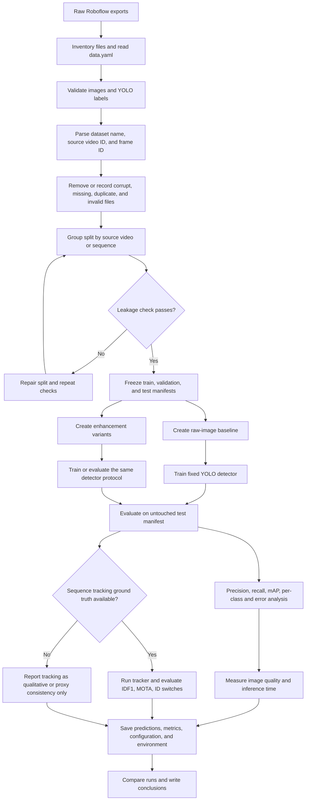

# Reproducible Pipeline Flowchart

## Workflow Contracts

### Input

- JPG image frames and parallel YOLOv8 label files.
- `data.yaml` class mappings and split paths.
- Filename-derived sequence information where available.

### Frozen artifacts

- `manifests/*.csv` containing image path, label path, dataset, source video ID, frame ID, and split.
- A versioned class mapping for each dataset.
- A run configuration containing model, image size, seed, augmentation, enhancement, and software versions.

### Output

- Model weights and training curves.
- Test predictions and confusion matrices.
- Detection metrics, timing measurements, and image-quality measurements.
- Tracking outputs only when appropriate ground truth exists.
